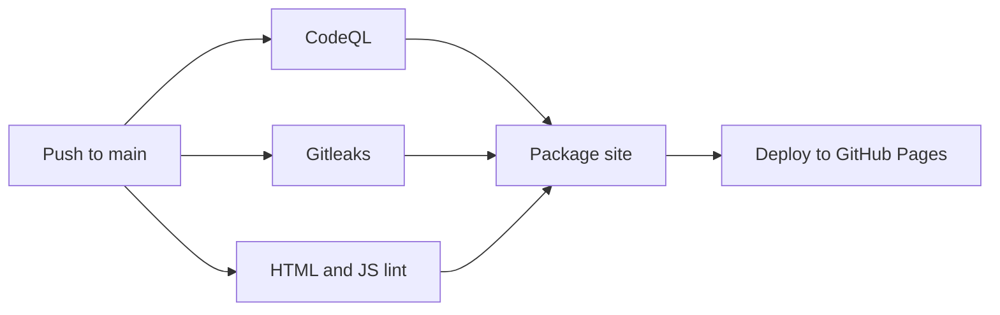

# Portfolio

[](../../actions/workflows/pipeline.yml)

The personal portfolio of Aniketh Indiresh Ail, a Cybersecurity Risk & GRC Analyst in Dublin, Ireland. It is a single page built with plain HTML, CSS and JavaScript, with an interactive terminal and three security mini-games.

## Project layout

| Path | Purpose |
| --- | --- |
| `index.html`, `style.css`, `script.js`, `assets/` | The website, and the only files that get published. Fonts are self-hosted in `assets/fonts/` under the SIL Open Font License. |
| `.github/workflows/pipeline.yml` | Security checks and deployment |
| `.github/dependabot.yml` | Weekly updates for the GitHub Actions in the pipeline |
| `eslint.config.mjs`, `.htmlhintrc`, `scripts/` | Lint rules |
| `SECURITY.md` | How to report a vulnerability |

## Running it locally

Open `index.html` in a browser. There is no build step.

To run the same lint checks as the pipeline, with Node.js 24 or later:

```sh
npm ci --ignore-scripts
npm run lint
```

## Security pipeline

Every push and pull request to `main` runs three checks. The site is only published when a push to `main` passes all of them.



### The checks

| Check | What it looks for | What makes it fail |
| --- | --- | --- |
| **CodeQL** | Vulnerabilities in the JavaScript, such as cross-site scripting and prototype pollution, using the `security-extended` queries | Any finding |
| **Gitleaks** | API keys, tokens and other secrets in commits | Any secret |
| **ESLint** | Unsafe HTML writes (`innerHTML`, `document.write`), `eval` and similar, unsafe regular expressions, and general code errors | Any error or warning |
| **HTMLHint** | Inline scripts, event handlers and styles, duplicate IDs, and malformed markup | Any error |
| **`check-html-security.mjs`** | A missing or weakened Content Security Policy, third-party resources, `<base>` tags, and `target="_blank"` links without `rel="noopener"` | Any problem |

A scheduled run repeats the checks every Monday, because new detection rules can find problems in old code. It reports a failure but doesn't change the live site. Gitleaks scans the full history on scheduled and manual runs, and only the new commits on pushes and pull requests.

### How the pipeline itself is hardened

- **Deployment depends on every check.** If any check fails or is cancelled, the packaging and deployment jobs don't run.
- **CodeQL findings block deployment.** The CodeQL action only reports what it finds and still succeeds, so a separate step reads the results and fails the job if there are any.
- **Least privilege.** The workflow has no permissions by default and each job requests only what it needs. Only the deploy job can change the live site.
- **Pinned actions.** Actions are pinned to full commit SHAs, because a version tag can be moved to different code.
- **Reviewed updates.** Dependabot opens one weekly pull request for action updates, after a 7-day wait. Those updates go through the same checks.
- **Allow-listed publishing.** Only the website's files are copied into the deployment, so config files and tooling never go live.
- **No install scripts.** Lint tools are installed at the exact versions in the lockfile, with install scripts turned off.

### If a check fails

- **Gitleaks found a secret:** treat it as compromised and revoke it first, because deleting it from the code doesn't remove it from Git history. For a false positive, add `gitleaks:allow` in a comment on that line.
- **CodeQL found something:** fix the code. Dismissing an alert in the Security tab won't unblock deployment, because the pipeline reads the scan results directly. For a confirmed false positive, exclude that rule with a `query-filters` entry in the CodeQL `config` input, and note why.
- **Lint failed:** run `npm run lint` locally to see the same errors.
- **The Content Security Policy check failed:** if the policy really does need to change, update `scripts/check-html-security.mjs` in the same commit, so the decision is visible in review.

### Repository settings

These can't be set from code, and the first one is essential:

1. **Settings > Pages > Build and deployment > Source: GitHub Actions.** If this stays on "Deploy from a branch", GitHub publishes every push to `main` directly and skips all of the checks.
2. **Settings > Advanced Security > Private vulnerability reporting: Enable.** The reporting link in `SECURITY.md` depends on this.
3. **Code scanning default setup: leave off.** It conflicts with this workflow's CodeQL job.
4. **Optional: a branch ruleset on `main`** that requires the `CodeQL`, `Gitleaks` and `HTML and JavaScript lint` checks, so failing changes can't be merged. Without it, they can still reach `main`, but they won't be deployed.

## Reporting a vulnerability

See [SECURITY.md](SECURITY.md).
